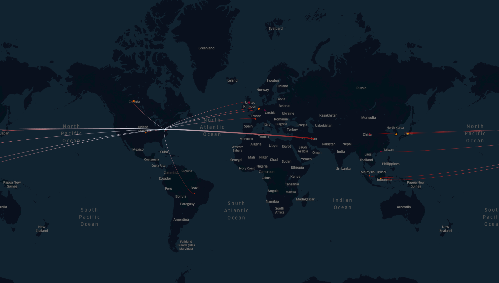
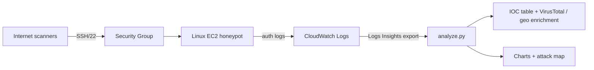
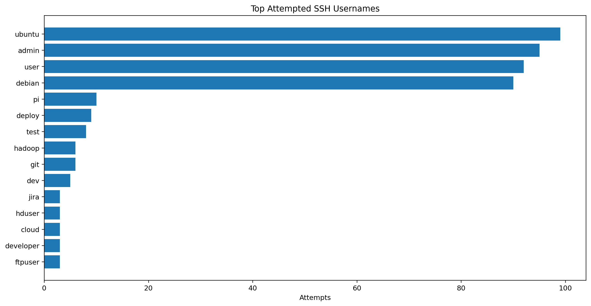
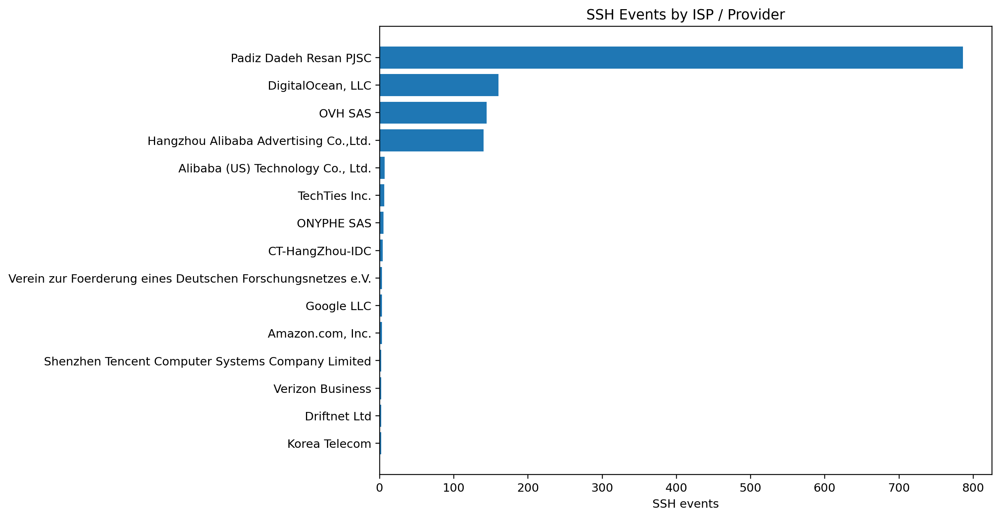

# AWS Cloud Threat Detection Lab

[](https://github.com/Jhesse00/AWS-Cloud-Threat-Detection-Lab/actions/workflows/tests.yml)


I exposed an isolated Linux EC2 instance on SSH/22, shipped its auth logs to CloudWatch, and investigated what hit it like a SOC analyst: parse, count, enrich, visualize, recommend.



## Results at a glance

| Metric | Result |
|---|---:|
| Failed SSH logins | **1,278** |
| Unique source IPs | **44** |
| Unique usernames guessed | **58** |
| Busiest source IP | `77.104.92.143`: **786 attempts (61.5%)** |
| Top IP/username pair | `77.104.92.143 → admin` (87 attempts) |

Every number above is recomputed from the CSVs in `data/` by `python analyze.py`, and CI checks it on every push.

## How it works



## Recommendation: close port 22, use Session Manager

The fastest fix for everything in this report is to stop exposing SSH:

1. Remove the `0.0.0.0/0` inbound rule for port 22 from the instance's Security Group.
2. Attach the AWS managed policy `AmazonSSMManagedInstanceCore` to the instance role.
3. Confirm the instance shows as **Managed** in Systems Manager → Fleet Manager.
4. Connect with `aws ssm start-session --target <instance-id>`. No inbound ports, no SSH keys, and every session is logged in CloudTrail.

If SSH must stay, restrict the Security Group to a known admin IP and disable password auth (`PasswordAuthentication no` in `/etc/ssh/sshd_config`).

## Reproduce the analysis

```bash
pip install -r requirements-dev.txt
python analyze.py            # summary table
python analyze.py --json     # machine-readable stats
pytest -q                    # 8 tests
```

## Global Attack Map


**Caption:** Attack map showing failed SSH login activity against an AWS EC2 honeypot. Source locations are based on IP geolocation and represent infrastructure location, not confirmed physical actor attribution.

## Architecture

```text
Internet scanners
      ↓
AWS Security Group allowing SSH/22
      ↓
Linux EC2 honeypot
      ↓
Linux authentication logs
      ↓
CloudWatch Logs
      ↓
Analysis, IOC extraction, enrichment, and visualization
```

## Tools and Technologies

AWS EC2, Security Groups, CloudWatch Logs, Linux, journalctl, Python standard library, matplotlib, Kepler.gl, BulkIPLab, and VirusTotal.

## Visualizations

### Top SSH Source IPs


### Top IP / Username Pairs


### Top Attempted Usernames



### SSH Events by Country


### SSH Events by ISP / Provider



## CloudWatch Logs Insights Queries

See [`queries/cloudwatch_logs_insights.md`](queries/cloudwatch_logs_insights.md).

## Linux Log Collection Commands

See [`queries/linux_log_collection.md`](queries/linux_log_collection.md).

## IOC and Reputation Table

See [`docs/ioc-reputation-table.md`](docs/ioc-reputation-table.md).

## Analysis Script

[`analyze.py`](analyze.py) recomputes the headline statistics directly from the
raw CSV data in `data/`, so the published figures can be verified or the
analysis re-run on a fresh capture. It uses only the Python standard library.

```bash
# Print the summary table
python analyze.py

# Emit the stats as JSON
python analyze.py --json

# Show the ten most-guessed usernames
python analyze.py --top-usernames 10
```

Run the tests with:

```bash
pip install -r requirements-dev.txt
pytest
```

## Important Note on Attribution

This project uses IP geolocation and reputation enrichment for security context. Country-level geolocation does **not** prove the physical location or identity of the attacker. It only indicates where the observed IP infrastructure is registered or geolocated.

## Cleanup

See [`docs/cleanup-checklist.md`](docs/cleanup-checklist.md).
