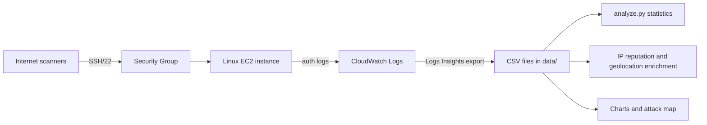
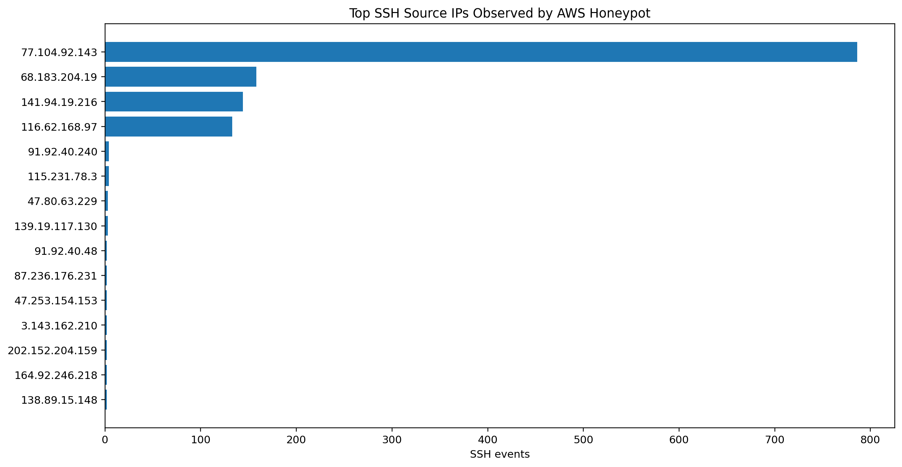
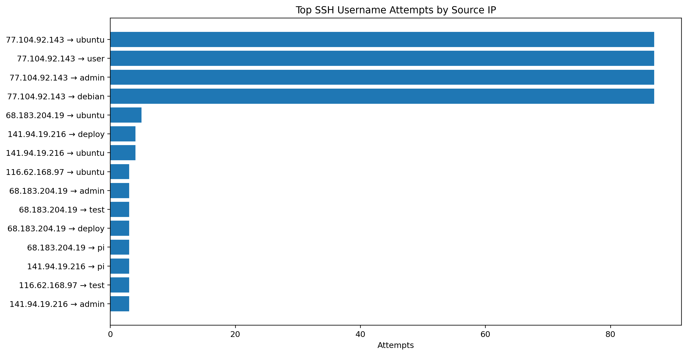
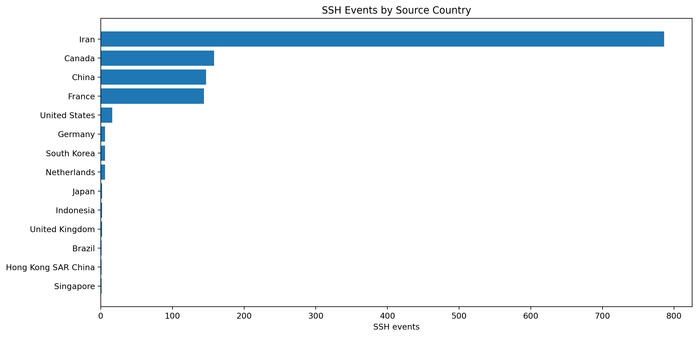

# AWS Cloud Threat Detection Lab

[](https://github.com/Jhesse00/AWS-Cloud-Threat-Detection-Lab/actions/workflows/tests.yml)

An isolated Linux EC2 instance was exposed on SSH/22 and its authentication logs were sent to CloudWatch Logs. The exported failed-login data was counted, enriched with IP reputation and geolocation, and visualized.


## Results

| Metric | Result |
|---|---:|
| Failed SSH logins | 1,278 |
| Unique source IPs | 44 |
| Unique usernames attempted | 58 |
| Busiest source IP | `77.104.92.143`: 786 attempts (61.5%) |
| Top IP/username pairs | `77.104.92.143` with `admin`, `debian`, `ubuntu`, and `user`, 87 attempts each |

`analyze.py` recomputes these figures from the CSV files in `data/`. Sample output:

```text
SSH Honeypot Analysis
==============================
Total failed SSH events : 1,278
Unique source IPs       : 44
Top attacker IP         : 77.104.92.143 (786 attempts, 61.5% of all events)
Username attempts       : 541
Unique usernames guessed: 58
Top IP/username pair    : 77.104.92.143 → admin (87 attempts)
```

The script breaks the four-way tie for the top pair alphabetically, so it reports `admin`.

Geolocation shows where IP infrastructure is registered or located. It does not identify the person behind the traffic.

## How it works



- Log collection commands: [`queries/linux_log_collection.md`](queries/linux_log_collection.md)
- CloudWatch Logs Insights queries: [`queries/cloudwatch_logs_insights.md`](queries/cloudwatch_logs_insights.md)
- IOC and reputation table: [`docs/ioc-reputation-table.md`](docs/ioc-reputation-table.md)
- Full write-up: [`reports/final-report.md`](reports/final-report.md)

`analyze.py` uses only the Python standard library. The charts in `visualizations/` are pre-rendered matplotlib images, and the attack map was made with Kepler.gl. Reputation data comes from BulkIPLab and VirusTotal.

## Setup

CI uses Python 3.12. `analyze.py` has no dependencies; the tests need pytest:

```bash
pip install -r requirements-dev.txt
```

## Usage

```bash
python analyze.py                     # summary table
python analyze.py --json              # statistics as JSON
python analyze.py --top-usernames 10  # also list the 10 most-attempted usernames
python analyze.py --data-dir PATH     # read the CSV files from another directory
```

## Tests

```bash
pytest -q
```

The tests compare computed statistics with `data/project_stats.json` and check the helpers on synthetic and empty data. GitHub Actions runs `pytest -q` and `python analyze.py --json` on pull requests and on pushes to `main`.

## Visualizations

| | |
|---|---|
|  |  |
|  |  |
|  |  |

## Recommendation

Do not expose SSH to the internet. Use AWS Systems Manager Session Manager instead:

1. Remove the `0.0.0.0/0` inbound rule for port 22 from the Security Group.
2. Attach the AWS managed policy `AmazonSSMManagedInstanceCore` to the instance role.
3. Confirm the instance appears as managed in Systems Manager Fleet Manager.
4. Connect with `aws ssm start-session --target <instance-id>`.

If SSH must stay open, allow only known admin IPs and set `PasswordAuthentication no` in `/etc/ssh/sshd_config`.

To tear down the lab, follow [`docs/cleanup-checklist.md`](docs/cleanup-checklist.md).

## Project structure

```text
analyze.py         Statistics from data/*.csv
data/              Exported and enriched CSV data, recorded stats
queries/           Log collection commands and Logs Insights queries
docs/              IOC table, cleanup checklist
reports/           Final report
visualizations/    Charts and attack map
tests/             pytest tests for analyze.py
```

## License

MIT. See [LICENSE](LICENSE).
