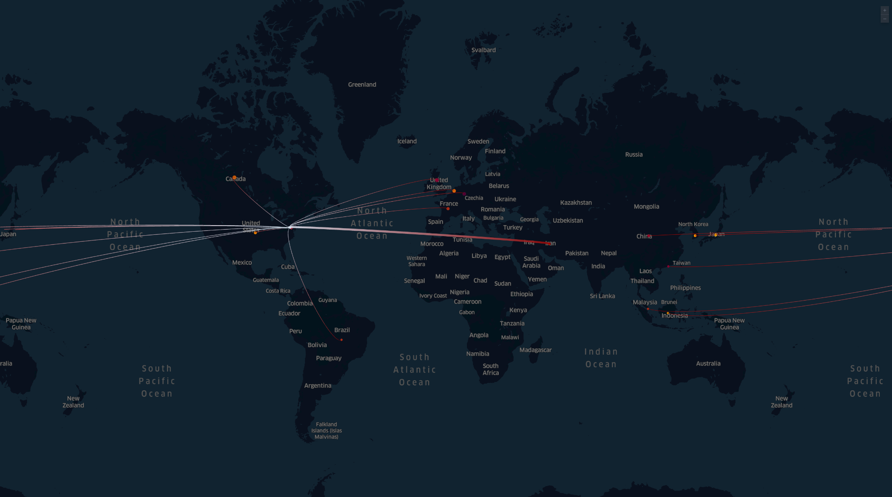
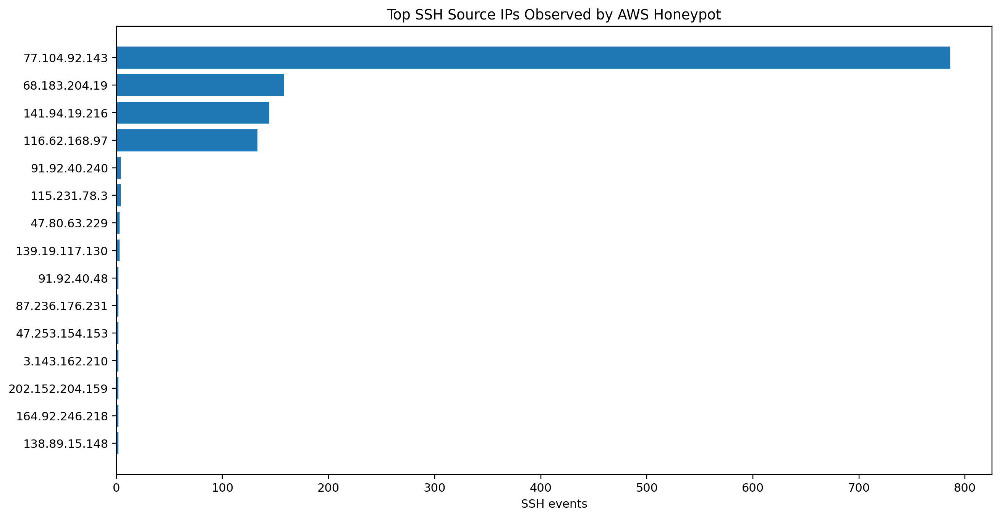
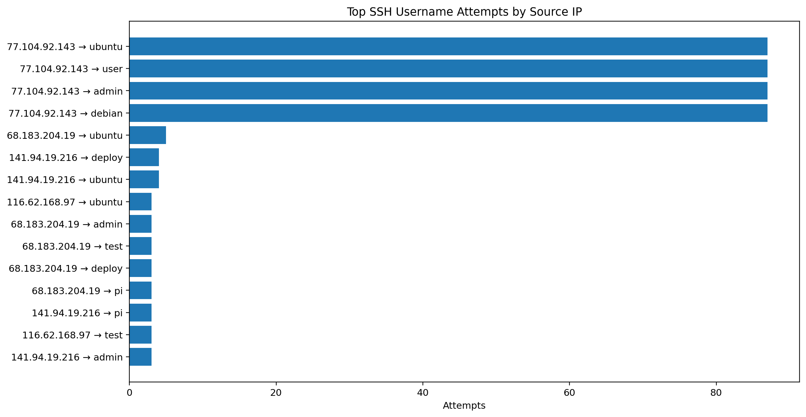
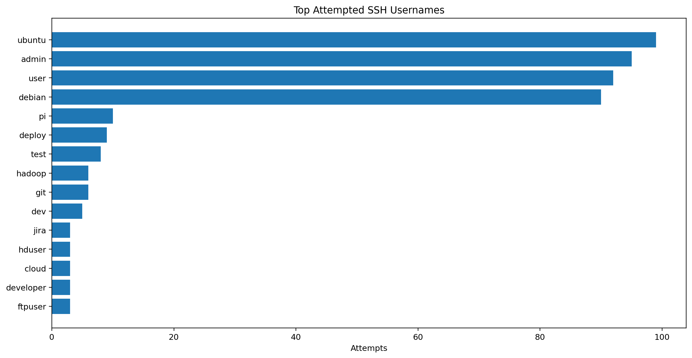
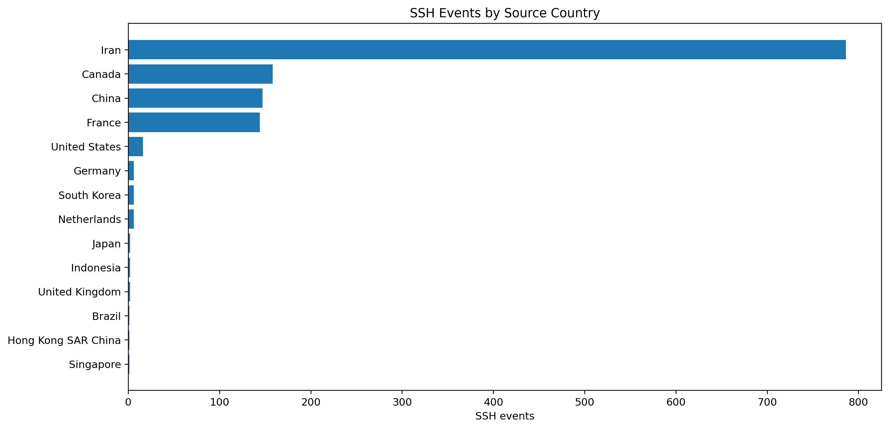
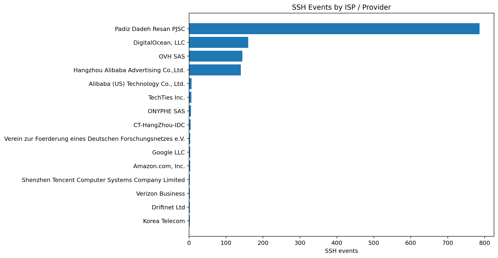

# AWS Cloud Threat Detection Lab

## Overview

I built an AWS Cloud Threat Detection Lab using an isolated Linux EC2 instance as a controlled SSH honeypot. The goal was to observe real-world automated scanning and failed SSH login activity, forward system telemetry into CloudWatch, extract IOCs, enrich the source IPs, and document the investigation like a SOC workflow.

## Final Results

| Metric | Result |
|---|---:|
| Total failed SSH login events | 1,278 |
| Unique attacker/source IPs | 44 |
| Top attacker IP | `77.104.92.143` |
| Top IP activity | 786 failed SSH login events |
| Username attempts analyzed | 541 |
| Unique usernames guessed | 58 |
| Top IP/username pair | `77.104.92.143 → ubuntu (87 attempts)` |

## Global Attack Map



**Caption:** Attack map showing failed SSH login activity against an AWS EC2 honeypot. Source locations are based on IP geolocation and represent infrastructure location, not confirmed physical actor attribution.

## What I Built

- Deployed an isolated Linux EC2 instance in AWS.
- Temporarily exposed SSH on port 22 to the public internet.
- Forwarded system telemetry into CloudWatch.
- Parsed failed SSH login events from Linux authentication logs.
- Extracted source IPs, attempted usernames, and event counts.
- Enriched source IPs using BulkIPLab/VirusTotal-style reputation data.
- Created visualizations, IOC tables, CloudWatch queries, and a final report.

## Architecture

```text
Internet scanners
      ↓
AWS Security Group allowing SSH/22
      ↓
Linux EC2 honeypot
      ↓
Linux authentication logs
      ↓
CloudWatch Logs
      ↓
Analysis, IOC extraction, enrichment, and visualization
```

## Tools and Technologies

AWS EC2, Security Groups, CloudWatch Logs, Linux, journalctl, Python, pandas, matplotlib, Kepler.gl, BulkIPLab, and VirusTotal.

## Lab Findings

- **1,278** total failed SSH login events from **44** unique attacker/source IPs.
- Top attacker IP: **77.104.92.143**, geolocated to Iran, with **786** failed SSH login attempts.
- **58** unique usernames were guessed.
- Attackers heavily targeted default cloud/Linux usernames such as `ubuntu`.
- Source IPs were enriched with country, ISP/provider, IP reputation, AbuseIPDB, and last-checked context.

## Visualizations

### Top SSH Source IPs



### Top IP / Username Pairs



### Top Attempted Usernames



### SSH Events by Country



### SSH Events by ISP / Provider



## CloudWatch Logs Insights Queries

See [`queries/cloudwatch_logs_insights.md`](queries/cloudwatch_logs_insights.md).

## Linux Log Collection Commands

See [`queries/linux_log_collection.md`](queries/linux_log_collection.md).

## IOC and Reputation Table

See [`docs/ioc-reputation-table.md`](docs/ioc-reputation-table.md).

## Key Takeaway

Cloud exposure is instant, and the public internet is hostile. Management ports like SSH should not be left open to the world. Security Groups should be audited, SSH should be restricted, and safer access methods like AWS Systems Manager Session Manager should be considered.

## Important Note on Attribution

This project uses IP geolocation and reputation enrichment for security context. Country-level geolocation does **not** prove the physical location or identity of the attacker. It only indicates where the observed IP infrastructure is registered or geolocated.

## Cleanup

See [`docs/cleanup-checklist.md`](docs/cleanup-checklist.md).
